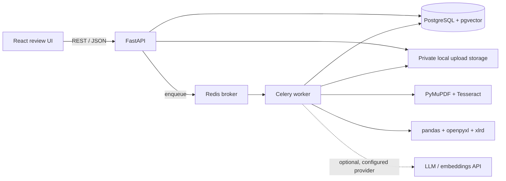

# Architecture and data model

## Runtime architecture

The API validates the filename extension, enforces per-file byte limits, stores
uploads under generated UUID-based names, computes a SHA-256 digest, and queues
processing. Workers validate file signatures and parse the content. AI output
is not authoritative: unknown values stay null, and validation discrepancies
or uncertain extraction are surfaced for review.

The API applies the Alembic migration at startup. A Celery worker must also be
running for queued documents to progress. For local Windows development, run
Celery with the `solo` pool.

## Persisted schema

| Table | Important fields | Purpose |
|---|---|---|
| `documents` | `id`, `original_filename`, `media_type`, `sha256`, `size_bytes`, `file_path`, `status`, `progress`, `extracted_text`, `extracted_data` (JSONB), `validation_issues` (JSONB), `invoice_number`, `supplier_name`, `invoice_total`, `embedding` (1536-dimension vector), timestamps | Source metadata, processing state, extracted invoice result, validation output, and search index |
| `processing_attempts` | `id`, `document_id`, `status`, `error_code`, `error_message`, `duration_ms`, `created_at` | Retry history and processing outcome |

Indexes support document status, upload hash, invoice number/supplier lookups,
and attempt-to-document joins. PostgreSQL's `vector` extension is installed by
the initial migration. The extraction payload remains JSONB to preserve
optional fields and line items without pretending that every source document
has the same shape.

## Processing and validation

1. The upload endpoint accepts PDF, JPEG/PNG/TIFF, XLSX/XLS, or CSV, up to 10
   files per request and 25 MiB per file by default.
2. A Celery worker checks the file signature, enforces a configured page/frame
   limit, extracts PDF text, uses Tesseract for sparse PDF pages and images,
   and parses every spreadsheet sheet.
3. Label-based extraction runs locally. If fully configured, an
   OpenAI-compatible chat-completions provider may supply structured fields;
   the document text is treated as untrusted data.
4. Validation checks required fields, numeric/non-negative amounts, subtotal
   plus tax versus total, line-item sums, duplicate invoice identifiers, and
   totals that conflict with an existing document from the same supplier.
5. The worker stores attempt status and elapsed time. The UI polls status and
   allows field correction, revalidation, and retry after processing failure.
6. Keyword search is local to PostgreSQL. Semantic search is available only
   when a configured provider returns 1536-dimensional embeddings.

## API operations

The API exposes document upload/list/detail/status/result/attempts, manual
correction, retry, keyword search, and semantic search. FastAPI's `/docs`
provides the current request and response schemas.

## Security and operational boundaries

The demo keeps files on local disk and does not implement user authentication,
malware scanning, retention/deletion policy, upload rate limits, or managed
object storage. Do not expose it publicly or use it for real customer data
without addressing those concerns. AI provider calls are opt-in and may send
document text outside the local environment; configure them only with
appropriate authorization and data handling.
